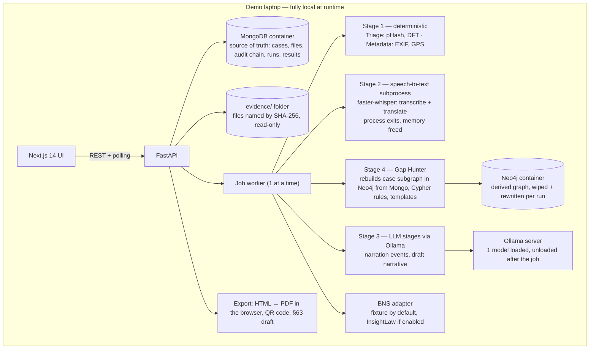

TRACE — 20-Hour Hackathon Build Plan
Version 2.1 · 16 Oct 2026 · Team: G, V, N (3 people)
Scoped down from the 9-month pilot requirements (`docs/PRD.md`, `docs/TRD.md`, `docs/SRS.md`, `docs/README.md`) and the hardening answers in `Trace-QnA.docx`. The UI flows follow `trace_ui_demo.html` (the clickable demo of all screens).
> This is a **demo-grade build**, not the pilot. Every cut from the full spec is listed in §1, so nothing is silently dropped. The plan works for any answer to the open questions in §12: each one has a default that is already built in.
What changed from v2.0 of this plan
Storage is now persistent and non-relational: **MongoDB** replaces SQLite as the single source of truth, and **Neo4j** replaces in-memory networkx for Gap Hunter's graph. Both run as Docker containers, started together at H0 before the three workstreams split (§2, §5, §8).

What changed from v1 of this plan
Models are loaded one at a time: speech-to-text runs in its own process and exits before the LLM starts. This avoids out-of-memory crashes on consumer hardware (§4).
The pipeline runs as a background job. The UI polls for status, so no browser request waits on the pipeline (§5).
MongoDB is the single source of truth, with a single job worker so there is no write contention to design around (§5).
Gap Hunter only checks the current case. It has 6 deterministic rules and fixed neutral question templates, with no LLM in its decision path (§6.4).
Translation comes from Whisper's own translate mode, not the 8B LLM. Small local models are weak at Malayalam (§6.3).
Evidence the timeline depends on is text-based (chat export, SMS, call log). Running OCR on screenshots is a stretch goal (§6.3).
InsightLaw is mocked by default with a local fixture. The live call sits behind a flag (§6.5).
The PDF is rendered by a browser, because reportlab can't shape Malayalam script correctly (§6.6).
A "golden run" cache and a pre-recorded Malayalam clip keep the demo safe from live failures (§9).
Work is rebalanced: G now owns the deterministic agents (Triage and Metadata). V owns everything that touches a model (§7).
An hour-by-hour schedule has 3 integration checkpoints, a code freeze and a cut list (§8).
Roles are Officer and SHO rather than Officer and Admin, because "the officer files; the SHO approves" is a product principle that should show in the demo.
---
1. Cuts from the full spec
Full-spec item	Hackathon substitute	Why
Claude API behind an LLM Gateway	Ollama, local (model chosen at H1 by benchmark, §4)	Everything local; no data-residency question to defend on stage
PostgreSQL 15 + Apache AGE (the pilot's single-ACID-transaction design)	**MongoDB** (source of truth: cases, files, audit chain, runs, results) + **Neo4j** (Gap Hunter's graph, rebuilt from Mongo per job, never the source of truth)	Both run as Docker containers (no GPU needed), confirmed available on the demo machine. Neo4j is always rebuildable from Mongo, so there's no dual-write drift even with two engines — same principle the pilot's AGE design and v2's networkx choice both relied on, just with persistence this time
Celery + Redis job queue	One in-process background worker (FastAPI startup task plus an asyncio queue, 1 job at a time) with polling	No broker to install. Requests never block
Self-built BNS/IT Act corpus	InsightLaw adapter, mocked by default + local rules for the "required ingredients" view	The API contract is unknown and the venue network is unreliable
BSA §63 PKI signing	Pre-filled certificate, labelled "Draft — officer signature required"	No e-Sign credentials at a hackathon
Full role-based access, admin console, user management	2 hard-coded demo accounts: Officer, SHO	The approval step stays visible; administration isn't judged
Whisper vs Indic model benchmark	faster-whisper, one model picked at H1	No time to compare models; word-error-rate (WER) validation is post-hackathon
OCR of screenshots	Stretch only (Tesseract English)	Without it, screenshots still go through dedup, screening and metadata; the timeline uses text evidence
Audio deepfake screening, video evidence	Out of scope. Video isn't accepted	Not in v1 of the PRD either
Daily station digest, multi-station sync	Out of scope	No second station in a demo
Docker Compose for the **full app** (frontend/backend/Ollama)	**Non-optional, but scoped to Mongo + Neo4j only** (H0); frontend/backend/Ollama still run natively	GPU passthrough to Docker on Windows needs WSL2 + the NVIDIA container toolkit — high setup risk. Mongo and Neo4j need no GPU, so containerising just those two is safe and avoids per-OS native installs
Unchanged, because they are the product: the four agents, the SHA-256 custody chain from intake, the Malayalam original kept beside the English, neutral gap questions, advisory BNS suggestions with evidence, sentence-level source links, "the officer files, not the AI", and a QR-verifiable export.
---
2. Architecture

LangGraph wraps stages 1–4 as a `StateGraph` with 6 nodes: `triage`, `metadata`, `asr`, `timeline`, `gaps`, `draft`. Triage and metadata are deterministic and fast, so they run one after the other inside the graph; nothing is gained from parallel edges on one machine. LangGraph never holds a model in memory: nodes call out to the speech subprocess and to the Ollama HTTP API. If LangGraph wiring isn't working by H11, replace it with a plain Python function that calls the same 6 node functions (cut list, §8). The node functions are written so this swap takes about 10 minutes.
---
3. Tech stack
Layer	Choice	Notes
Frontend	Next.js 14 (App Router), Tailwind, shadcn/ui; vis-timeline (fallback: a plain ordered list)	N works against `mock/*.json` until each endpoint is live
Backend	FastAPI, Python 3.11, `pymongo`/`motor`, `neo4j` driver, Pydantic v2	One process, plus the speech subprocess, the Ollama server, and the Mongo/Neo4j containers
Orchestration	LangGraph `StateGraph`	Fallback: a plain function (§2)
LLM	Ollama. Default `qwen2.5:7b-instruct` or `llama3.1:8b`, both 4-bit quantised; CPU fallback `qwen2.5:3b-instruct`	Chosen at H1 (§4). `temperature 0`, JSON-schema `format` output, `keep_alive 0` on the last call of a job
Speech-to-text	faster-whisper, `medium` (GPU, float16) or `small` (CPU, int8), Malayalam set explicitly	Run twice: `task=transcribe` (Malayalam original) and `task=translate` (English)
NER / normalisers	spaCy `en_core_web_sm` + regex for phone (E.164), UPI ID, IFSC, account number, ₹ amounts	Run on the English text
Vision	imagehash (pHash), OpenCV (DFT screening), Pillow + piexif (EXIF)	Deterministic and CPU-only
Graph	**Neo4j** (Community Edition, official Docker image), case subgraph deleted and rewritten from Mongo at the start of each Gap Hunter stage	Max 3 hops; skips common nodes (§6.4). Never the source of truth — always rebuildable
Export	HTML template → PDF printed by the browser; `qrcode` (Python) produces a PNG embedded in the HTML	Correct Malayalam script rendering. No WeasyPrint/GTK install on Windows
Storage	**MongoDB**, single client with connection pooling; collections `cases`, `files`, `audit_chain`, `runs`, `timeline_events`, `gaps`, `drafts`, `bns_decisions`	Single job worker, so no write contention to design around; Pydantic models in one shared `schemas.py` act as the de facto schema
Containers	Docker Compose: `mongo`, `neo4j` only	No GPU passthrough needed for either; Ollama and the ASR subprocess stay native
---
4. Memory plan: avoiding out-of-memory crashes on demo hardware
The problem. faster-whisper `medium` (about 1.5–2.5 GB of GPU memory) plus an 8B model at 4-bit (about 5–6 GB) don't fit together on an 8 GB GPU. Falling back to the CPU turns seconds into minutes. These figures are approximate; measure them at H1 on the demo machine with `nvidia-smi`.
The rule: one model in memory at a time, enforced by process boundaries, not by hoping garbage collection frees it.
Speech-to-text runs in a child process (`python -m trace.asr <file>`). It loads Whisper, writes the transcript JSON, and exits, which releases all its memory. The worker waits for it to finish.
Ollama runs with `OLLAMA_MAX_LOADED_MODELS=1` and `OLLAMA_NUM_PARALLEL=1`. The last LLM call of a job sends `keep_alive: 0`, so the model unloads straight away.
The order inside a job is fixed: deterministic stages → speech-to-text (process exits) → LLM stages → Gap Hunter (no model). Speech and the LLM never overlap.
Only one job runs at a time (a single worker), so two cases can't compete for memory.
Picking the hardware profile at H1 (V runs `scripts/bench.py`: the 75-second demo clip plus 3 LLM prompts):
Demo machine	Speech-to-text	LLM	Target run time (golden bundle)
GPU with 8 GB or more	`medium`, GPU, float16	7–8B at 4-bit, GPU	under 2 min
GPU with less than 8 GB	`small`, CPU int8 (GPU left free for the LLM)	7–8B at 4-bit, GPU	under 3 min
CPU only	`small`, CPU int8	`qwen2.5:3b-instruct`, CPU	under 6 min, so the golden-run cache is used on stage (§9)
What this means for the pilot. The TRD's reference hardware assumed a GPU server and a cloud LLM. If decision D1 becomes "local only", each station needs a GPU box, or several stations share a district inference server. Update TRD §2.11 after the hackathon. Process isolation is the right pattern for the pilot too.
---
5. Backend contracts (frozen at H1, so N can build against mocks)
Jobs, not long requests. `POST /api/cases/{id}/runs` returns `202 {run_id}` at once. The worker updates the `runs` document in MongoDB. The UI polls `GET /api/runs/{run_id}` every 1.5 seconds. No request is held open, so there are no 60–120 second browser or proxy timeouts. Server-Sent Events are optional polish, not a dependency.
Method	Path	Returns
POST	`/api/login`	`{user, role}` (2 demo accounts, cookie session)
GET / POST	`/api/cases`, `/api/cases/{id}`	Case list; create a case with complainant details and consent
POST	`/api/cases/{id}/files`	Multipart upload. For each file: `{id, name, sha256, status: accepted or rejected, reason}`
POST	`/api/cases/{id}/narration`	Audio upload (hashed like any other file)
POST	`/api/cases/{id}/runs`	`202 {run_id}`
GET	`/api/runs/{run_id}`	`{state, steps: [{name, state: waiting / running / done / failed / skipped, note}]}`
GET	`/api/cases/{id}/manifest`, `/timeline`, `/gaps`, `/draft`, `/bns`	Results (JSON shapes in `contracts/*.json`)
PATCH	`/api/gaps/{gid}`	Answer, or dismiss with a reason
PUT	`/api/cases/{id}/draft`	Save a new draft version
POST	`/api/bns/{sid}/decision`	Accept or reject (SHO only)
POST	`/api/cases/{id}/approve`	SHO only. Locks the draft version
POST	`/api/cases/{id}/export`	`{version, head_hash, html_url, json_url, cert_url}`
GET	`/api/verify/{case_ref}/{head_hash}`	`{result: match / mismatch / not_found, entry}`
GET	`/api/cases/{id}/audit`	Chain entries plus a verification result
MongoDB safety. One shared `pymongo`/`motor` client (connection pool), reused across requests and the worker. Each write is a single document insert/update — never a multi-document transaction — so there's nothing to hold open across a model call. Pydantic models in `schemas.py` validate every document shape before it's written, shared by G and V to prevent schema drift.
Custody chain (from Q&A §2, two layers of hashes), stored as an append-only `audit_chain` collection in MongoDB, ordered by insertion:
Raw layer: each original file is hashed while it streams in, then saved as `evidence/<sha256>` and set read-only. A `FILE_RECEIVED` entry is written before anything else reads the file.
Derived layer: each transcript, translation, metadata JSON or draft version is stored with the model name, prompt version, code version and its own SHA-256, in an `ARTIFACT_DERIVED` entry. An officer edit appends a new version; nothing is overwritten.
`entry_hash = SHA256(prev_hash || canonical_json(entry))`. Verification recomputes the chain from the start.
---
6. Agents: exact scope for 20 hours
6.1 Content Triage (G, deterministic)
Classify each file by magic bytes and filename into: financial record, conversation, media, call log, audio, other.
Compute pHash for images and group duplicates where the Hamming distance is 6 or less; mark the earliest as canonical.
Compute the DFT spectrum and look for periodic peaks above a threshold, combined with the JPEG quality estimate, to get a `screening_score` from 0 to 1. A score of 0.5 or more means "Recommend forensic review". Calibrate the threshold on the demo bundle only, and say so on stage.
The output wording is fixed: "No screening concern", "Recommend forensic review" or "Not screened", always with the limitations line. The UI never uses the words fake, forged, authentic or synthetic.
6.2 Metadata (G, deterministic)
Extract EXIF (capture time, make/model, software, GPS) with Pillow and piexif.
Flag a conflict when: an editing-software tag (Photoshop, Snapseed, PicsArt and similar) appears on a claimed phone photo or screenshot; the capture time is after the upload time; or GPS is more than 50 km from the place stated in the case.
Missing EXIF shows as "Not available" in neutral grey (WhatsApp strips it). It is never a warning.
Geocoding uses a small offline table of Kerala towns (about 30 rows, nearest within 40 km). There is no Nominatim server and no network call.
6.3 Timeline (V; mostly deterministic, LLM only for the narration)
Order of reliability, most reliable first:
Rule parsers (deterministic):
WhatsApp `.txt` exports: both the `dd/mm/yy, hh:mm -` and `[dd/mm/yy hh:mm]` formats.
Bank SMS `.txt`, using regex for amount, account, UPI ID, IMPS/NEFT and time.
Call-log `.csv`.
Every event carries `{file_id, line}`.
Narration: faster-whisper runs `transcribe` for the Malayalam original and `translate` for the English, with segment timestamps for each. The LLM (JSON schema output) pulls events from the English segments. Each event must cite the IDs of the segments it came from. Any event with no valid citation is dropped.
Merge: events within 5 minutes of each other with the same amount and account become one event that lists all its sources. Times are in IST, with precision marked as exact, date only or approximate.
Draft narrative: the LLM gets the ordered events and must return `[{sentence, event_ids[]}]`. A sentence with no event IDs, or with IDs that don't exist, is marked "Unsupported — needs officer review" in the UI and is never dropped silently (Q&A §3).
Malayalam read-back: use the Whisper Malayalam transcript as the original. Don't ask the 8B model to write Malayalam; it is unreliable.
6.4 Gap Hunter (V; deterministic graph rules, fixed templates)
Graph: at the start of every Gap Hunter stage, the worker deletes that case's existing subgraph in Neo4j (`MATCH (n {case_id: $id}) DETACH DELETE n`) and rewrites it from the MongoDB documents for the current case only — Neo4j is a derived view, Mongo stays the source of truth, so a crash mid-rebuild just means the next run rebuilds again, never a half-written graph feeding a live query. Nodes are Person, Phone, Account, UPI, Event, Transaction, File and Statement. Entities are normalised before insertion: phone numbers to E.164, UPI IDs lower-cased, IFSC codes checked by regex. Cypher traversals are limited to 3 hops (`[*1..3]`), and nodes with more than 20 connections are tagged `high_degree` at write time and excluded from traversal (common nodes such as "Bank"). If the Neo4j container is unreachable, the worker logs a warning and runs the same 6 rules against a lightweight in-memory rebuild instead, so Gap Hunter degrades rather than blocking the pipeline (same graceful-degradation principle as PRD §1.8).
6 rules for the demo:
Rule	Detects
G-01	A payment mentioned in the narration with no financial record
G-02	A named person with no contact recorded
G-03	More than 7 days between the last event and the report
G-05	An account with no IFSC or bank recorded
G-07	A contact or UPI ID in the evidence but not in the narration
G-09	The stated total loss ≠ the sum of the transactions
Fixed question templates, with blanks filled from the graph. No LLM is used here, so the wording is always neutral and can't drift. A test asserts that no template contains any word from a blocked list (lying, suspicious, deceptive, credibility, fake, contradiction).
A time mismatch is phrased as Q&A §3 recommends: "Complainant recalls about 4:00 PM; the bank record shows 5:12 PM. Consider gently clarifying the time window."
Re-run after the officer answers: rebuild the graph and re-run only the rules, which takes under a second.
6.5 BNS suggestions (V adapter, G fixture)
`bns_adapter.suggest(facts) -> [{section, title, ingredients[], matched_event_ids[]}]`.
Default mode is `fixture`: 4 entries for the demo story (BNS 318(4), BNS 319(2), IT Act 66C, IT Act 66D), each with its legal ingredients written out and mapped to events by local keyword rules. OTP shared → 66C; impersonating a bank → 319(2) and 66D; payment induced by deception → 318(4).
`live` mode calls InsightLaw if a key and docs exist (§12). It has a 5-second timeout, and on any error it falls back to the fixture and shows an "offline" note.
The UI layout follows Q&A §4: statute → required ingredients → supporting evidence for each ingredient. Every suggestion carries "Advisory: SHO decides".
Section numbers must be checked by a legal mentor before the demo (docs Appendix B).
6.6 Export
An HTML template (Jinja2) contains: the FIR draft fields, the narrative, the Malayalam original annex, the evidence manifest with hashes, the accepted sections, the head hash and the QR code (PNG).
The officer clicks Print / Save as PDF in the browser. Chrome shapes Malayalam correctly; reportlab doesn't.
The §63 certificate draft is a second HTML page listing the file hashes, labelled "Draft — officer signature required".
Verification: the QR code encodes `http://<laptop LAN IP>:3000/verify/<ref>/<head>`. On stage, scan it with a phone on the same hotspot, or click the printed link. `localhost` can't be reached from a phone, so set `PUBLIC_BASE_URL` at H17.
---
7. Task split
N works on the frontend only. G and V each own one backend area and join frontend integration at the checkpoints.
Owner	Owns	Deliverables
G — platform + deterministic agents	FastAPI scaffold, SQLite (WAL), models, upload with hashing, custody chain and verification, job worker and run status, Content Triage, Metadata, export (HTML, QR, §63 draft), verify endpoint, demo accounts, BNS fixture	Endpoints in §5 working against the golden bundle
V — everything that touches a model	`bench.py` and model choice, speech-to-text subprocess, Ollama client (JSON schema, retry, timeout), rule parsers, Timeline, narrative with source links, Gap Hunter (graph + rules + templates), LangGraph wiring, BNS adapter	`run_pipeline(case_id)` produces timeline, gaps, draft and BNS for the golden bundle
N — frontend	Login, case list, intake with consent, upload with per-file hash and status, analysis progress (polling), manifest with file detail, timeline, gap questions, draft with click-to-source, BNS cards, approval, export, verify page	All screens working on mocks by H6, wired to the real API by H15
Help rule. Whoever is ahead at a checkpoint takes the top unowned item from the cut list or from integration, never N's screens wholesale. N's spare time goes to the demo script and test data, not backend code.
Before the hackathon starts (check the event rules on what may be prepared in advance):
Pre-pull the Ollama models, faster-whisper `small` and `medium`, and the spaCy model. These are several GB, and venue Wi-Fi can't be trusted.
Prepare the golden evidence bundle and the Malayalam clip (§9).
If the rules allow pre-written code, keep it to a repo skeleton with no features.
---
8. Schedule (20 hours, 3 checkpoints)
Hours	G	V	N	Gate
H0 (~15 min, all 3 present)	`docker compose up -d mongo neo4j`; smoke-test a write/read against both; freeze `contracts/*.json` together with V and N	same	same	Containers up, contracts frozen
0–1	Repo scaffold; `schemas.py` (Pydantic models for Mongo collections); Mongo client + custody-chain writer	`bench.py` on the demo machine; choose the hardware profile (§4)	Next.js scaffold, layout, login, mock server	Models chosen
1–6	Upload + hashing + custody chain; job worker + run status; Triage	Speech subprocess (transcribe + translate); WhatsApp/SMS/CSV parsers; Ollama client	Case list, intake + consent, upload screen, progress screen (mocks)	CP1 (H6): real upload → hash → triage results shown in the real UI
6–11	Metadata; export HTML + QR; verify endpoint; BNS fixture	Narration event extraction; merge; Gap Hunter — Neo4j rebuild-per-run + Cypher rules + templates; LangGraph wiring	Manifest + file detail, timeline, gap questions (mocks, then real)	CP2 (H11): the full pipeline runs on the golden bundle; UI shows timeline + gaps. If LangGraph isn't working, switch to the plain function now
11–15	Gap answer/dismiss, draft versions, approve endpoints; audit view; golden-run cache	Draft narrative with source links + unsupported flag; BNS adapter + keyword mapping (inspect real InsightLaw response); re-run of gap checks	Draft with click-to-source, BNS cards, approval, export, verify	CP3 (H15): feature freeze. The whole demo path works end to end
15–17	Bug fixes; set `PUBLIC_BASE_URL`	Bug fixes; test the fallbacks (Ollama stopped, speech failure, Neo4j unreachable → in-memory Gap Hunter fallback); OCR (stretch)	Polish, empty and error states, Malayalam fonts	All fallbacks tested
17	Code freeze			Tag `demo-v1`
17–19	3 full rehearsals on the demo machine; record a backup video of a full run		Demo script and slides	Backup video saved locally
19–20	Buffer			
Rest: stagger one 60–90 minute rest per person between H6 and H15, never two people at once, and not across a checkpoint.
Cut list if behind, cut from the top first:
OCR
SSE (polling stays)
vis-timeline (use a plain list)
LangGraph (use the plain function)
DFT screening (keep pHash and the EXIF conflict, which still shows a referral)
Live InsightLaw (keep the fixture)
The §63 page
Never cut: hashing at intake, Malayalam beside English, neutral gaps, source links, the SHO approval step, and the "officer files" export.
---
9. Demo assets and safety net
Golden bundle (synthetic, fictional names and numbers; matches the sample case in `trace_ui_demo.html`):
File	Purpose
`whatsapp_chat_export.txt`	The link and the shared OTP
`bank_sms_alerts.txt`	4 debits totalling ₹1,60,000
`call_log.csv`	The first call
`screenshot_debit_01–04.jpg`	Near-duplicates, which shows dedup
`payment_receipt.png`	Carries an EXIF `Software=Adobe Photoshop` tag, which shows the metadata conflict and referral
`photo_passbook.jpg`	Has GPS EXIF, which shows the geocoding
`narration_ml.wav`	About 75 s, Malayalam, slow and clearly spoken, recorded in a quiet room. It mentions "Arun" and ₹25,000, which shows G-01, G-02 and G-09
Expected outputs, written down before the build (`golden/expected.json`): 11 events, the gaps that should fire, 4 BNS suggestions, 2 referrals. CI-style test: `pytest tests/test_golden.py` checks the pipeline output against this file. Run it at every checkpoint.
Test/demo database separation: MongoDB now keeps history across runs (no wipe before the demo — the case list showing prior cases is part of the demo). So `test_golden.py` runs against a separate database name (e.g. `trace_test` vs `trace_demo`) or a dedicated, clearly-labelled test case ID, so repeated test runs during the hackathon never show up in the case list on stage, and the live demo's case history is never disturbed by a test run.
Golden-run cache. After a good run, save every stage's output to `cache/<bundle_sha>.json`. If a stage fails or is too slow, the worker reads that stage's output from the cache when `DEMO_CACHE=1`, and the progress screen says "cached result". On stage, run live, with the cache switched on as a safety net.
Live-demo rules (from the risk review):
Never dictate Malayalam live. Upload the pre-recorded clip.
Don't depend on venue internet: the BNS fixture is the default.
Keep the backup video open in a second tab.
Demo script, 5 minutes:
Officer logs in, creates a case, records consent.
Uploads the bundle; hashes appear one by one.
Uploads the narration clip; Malayalam and English appear side by side.
Runs the analysis; the progress screen shows each stage.
Manifest: 4 screenshots collapsed into one; the receipt shows "Recommend forensic review" with its limitations line.
Timeline: click a source chip and the SMS line is highlighted.
Gap questions: answer G-01 by uploading the missing receipt, then re-run; 2 gaps close.
Draft: point at a sentence to see its sources; the unsupported-sentence flag is visible.
SHO signs in, accepts and rejects BNS suggestions, approves.
Export: print to PDF, scan the QR code, the verify page shows a match. Edit one byte in the database and the verify page shows a mismatch.
---
10. Definition of done (judging-day checklist)
[ ] The golden bundle runs end to end on the demo laptop with Wi-Fi off (fixture mode).
[ ] Running the pipeline twice in a row causes no out-of-memory error (`nvidia-smi` shows the model unloaded between runs).
[ ] No API request takes longer than 2 s. The pipeline is polled.
[ ] Every timeline event and every draft sentence links to a source, or carries an "Unsupported" flag.
[ ] No gap text contains a blocked word (the test passes).
[ ] The Malayalam original appears next to the English in the narration screen and the export.
[ ] Custody chain verification passes, and fails at the right entry after a deliberate change.
[ ] The QR code opens the verify page from a phone on the same hotspot.
[ ] The SHO approval is required before export.
[ ] The backup video is recorded, and the cache switch has been tested.
---
11. Risk register
Risk	Effect	Mitigation	Owner
Out of GPU memory with speech + LLM together	Critical: crash, or a 10× slowdown	One model at a time; speech in a child process; `OLLAMA_MAX_LOADED_MODELS=1`, `keep_alive 0`; hardware profile chosen at H1 (§4)	V
MongoDB or Neo4j container fails to start on demo hardware	Critical: nothing persists, Gap Hunter has no graph	Pre-pull both images before the event; `docker compose up -d mongo neo4j` as the literal first command at H0 (everyone present); smoke-test a write/read before building anything else	G
Neo4j write-then-crash leaves a stale graph for a case	Medium: gap rules run on outdated graph	Worker always deletes and rewrites the full subgraph for a case at the start of Gap Hunter's stage — never an incremental update (§6.4)	V
Neo4j driver/version friction (`neo4j` Python package, bolt protocol)	Low–Medium: setup delay	Pin the driver version at H0; G verifies a trivial Cypher round-trip before V writes real queries	G
MongoDB schema drift (no fixed schema) causes silent bugs across G/V's collections	Medium	Shared `schemas.py` (Pydantic models for every document shape), imported by both G and V	G
Browser or proxy timeout on a long run	High: the UI shows a 504	`202` + polling; no long-held requests (§5)	G
Graph queries slow on historical data	Medium	Current case only, 3 hops, common nodes skipped (§6.4); cross-case checks are a post-hackathon feature
Malayalam speech recognition makes things up	High: nonsense FIR	Pre-recorded clear clip; Whisper translate mode; LLM events must cite segments; cached transcript fallback	V
InsightLaw down, rate-limited or undocumented	High: no BNS suggestions	Fixture by default; live behind a flag with a 5 s timeout and fallback (§6.5)	V/G
LLM invents facts in the narrative	High: credibility	JSON output with event IDs; invalid IDs flagged as unsupported; temperature 0	V
Gap wording sounds accusatory	High: breaks a principle	Fixed templates, no LLM, blocked-word test	V
V overloaded	Critical: no working pipeline	Deterministic agents moved to G; plain-function fallback for LangGraph; strict checkpoints	All
Venue Wi-Fi or model downloads	High	Pre-pull all models and fonts; everything works offline	All
WeasyPrint/GTK install fails on Windows	Medium	Browser print to PDF (§6.6)	G
Hackathon rules limit pre-built work	Medium	Check the rules before the event; prepare only data and model downloads if code isn't allowed	All
---
12. Open questions, each with a default
Question	Default if unanswered
InsightLaw: response shape (confirmed: `GET https://insightlaw.in?q=<term>`, no visible auth key, response JSON structure unknown)?	Fixture is the default. V/G run the sample script at H1, inspect the real response, and build the live adapter path against it — fixture stays the fallback on any error (§6.5)
Demo machine: GPU model and memory?	Confirmed CPU-only. Use the CPU row of §4's table: `faster-whisper small` (CPU int8) + `qwen2.5:3b-instruct` (CPU); golden-run cache switched on for stage
Do the event rules allow preparing data and models in advance?	Assume data and model downloads are allowed and code isn't
Has a legal mentor checked the 4 section numbers?	Show them labelled "Advisory — sections to be verified"
