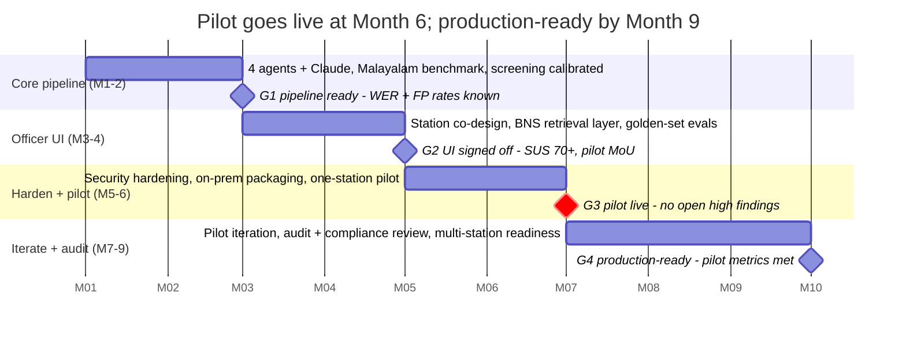

# TRACE — Product Requirements Document (PRD)

Version 1.0 · 16 Oct 2026

> Part of the TRACE requirements set. Shared decisions (D1–D7), glossary, legal references and open questions live in [README.md](README.md). Companion documents: [PRD](PRD.md) · [TRD](TRD.md) · [SRS](SRS.md).

## 1.1 Summary

TRACE is an AI case-assembly assistant for the police station counter. It turns a pile of raw complaint evidence and a spoken Malayalam or English account into a structured draft FIR. The draft contains an ordered narrative, an evidence manifest with authenticity flags, advisory BNS section suggestions with citations, and a list of questions to ask **while the complainant is still present**. The officer reviews, edits and files. TRACE never files anything itself.

The beachhead is cyber-fraud and financial-crime complaints at Kerala Cyber Police Stations. These complaints carry the most evidence, depend most on getting the order of events right, and are increasingly mixed with synthetic media.

## 1.2 Problem

The FIR is the foundation of an Indian criminal case, yet it is still put together by hand under time pressure. Four failures keep recurring:

| Failure | What happens today | Consequence |
| --- | --- | --- |
| Incomplete first reports | Missing details go unnoticed until the investigating officer opens the file weeks later | Screenshots have been deleted and memories have faded by the time anyone asks |
| No chronology | Evidence arrives as an unordered pile | In fraud cases the order of transactions *is* the offence, and it is rarely reconstructed properly |
| Unverified media | There is no way to separate an authentic screenshot from a synthetic one, and forensic labs are months behind | Almost nothing is referred, and fabricated evidence goes unexamined |
| Language loss | The complainant speaks Malayalam and the FIR is written in English through an unrecorded translation | Names and specifics are lost, and the translation can't be audited |

Today this takes 45–90 minutes per complaint, by the team's own estimate. A baseline study in pilot Month 1 will confirm the figure.

## 1.3 Goals and non-goals

**Goals for v1 (pilot)**

1. Cut the officer's time to assemble an FIR for an evidence-heavy cyber complaint by at least 50% against the measured baseline.
2. Surface missing information at intake, so more gaps are closed before the complainant leaves.
3. Give the forensic lab a ranked referral list with stated confidence, in place of today's all-or-nothing referrals.
4. Start the chain of custody at the counter, with tamper-evident hashing of every file and every action.
5. Keep the original Malayalam visible and auditable next to the English.

**Non-goals**

- Deciding whether media is authentic. TRACE flags files for review; it never gives a verdict.
- Scoring the complainant's credibility or detecting deception, in any form.
- Filing or submitting an FIR automatically.
- Investigation after the FIR is registered, case management, or court filings.
- Replacing CCTNS or the state e-FIR portal.

## 1.4 Users and personas

| Persona | Role | Needs from TRACE | Main worry |
| --- | --- | --- | --- |
| **FIR writer** (primary) | Constable or head constable who drafts the FIR at the counter | Gets from a pile of evidence to a clean English draft fast, with a checklist of what to ask | "Will this slow me down or make me look wrong?" |
| **Station House Officer (SHO)** (primary) | Approves and signs the FIR, accountable for its quality | Can trust the draft, see the evidence flags, and act on advisory sections with citations | Legal accountability; AI making claims it can't back up |
| **Investigating Officer (IO)** (secondary) | Picks up the case after registration | A complete file, a timeline, the hashed evidence and an open-questions log | Gaps found too late |
| **Complainant** (indirect) | Often a woman, a senior citizen or a fraud victim, under stress | Is heard in their own language, is asked the right questions once, and leaves with a reference | Being disbelieved; repeating a traumatic account |
| **Forensic analyst** (secondary) | State Forensic Science Laboratory or Cyberdome analyst | A short, ranked list of files to examine, with the reasons and the original hashes | Noise; referrals without a clear reason |
| **Station administrator / auditor** | Manages users, reviews audit logs | User management, a complete audit trail, export for inquiries | Data leaks; actions that can't be traced |

## 1.5 Core journey at the counter

1. The officer opens a new case and records the complainant's details and consent.
2. The officer uploads the evidence bundle: screenshots, chat exports, bank SMS or statements, call logs, photos and audio. Each file is hashed into the custody chain the moment it arrives.
3. The complainant narrates the incident by voice in Malayalam or English. TRACE transcribes it and shows the original next to the English translation.
4. TRACE runs triage and metadata extraction on every file, then builds the timeline and runs the gap checks. Progress is shown live.
5. The officer works through the **gap questions** with the complainant, adding answers or more files. Affected steps re-run.
6. The officer reviews the draft FIR: edits the narrative, accepts or rejects suggested BNS sections, and confirms the forensic referral list.
7. The SHO approves the draft. TRACE exports a PDF with a QR verification code, a JSON file and the evidence manifest. The officer files the FIR through the official channel.

## 1.6 User stories

| ID | As a… | I want to… | So that… | Priority |
| --- | --- | --- | --- | --- |
| US-01 | FIR writer | upload 40+ files in one go, including duplicates | I don't have to sort them first | M |
| US-02 | FIR writer | see duplicate screenshots collapsed into one | the manifest stays readable | M |
| US-03 | FIR writer | record the complainant's account in Malayalam and see an English translation beside the original | nothing is lost in translation | M |
| US-04 | FIR writer | see all events ordered on one timeline with the source of each | I can write the narrative in the right order | M |
| US-05 | FIR writer | get a list of missing information phrased as neutral questions | I can ask them before the complainant leaves | M |
| US-06 | FIR writer | edit any part of the draft narrative | the final wording is mine | M |
| US-07 | SHO | see suggested BNS sections with the matching facts and the statute text | I can decide quickly and defensibly | M |
| US-08 | SHO | see which files are flagged for forensic review, with confidence and limitations | I refer only what matters | M |
| US-09 | SHO | approve a draft and export a QR-verifiable PDF | the record can be checked for tampering later | M |
| US-10 | IO | open a case and see its timeline, evidence hashes and the history of resolved and open gaps | I start with a complete file | S |
| US-11 | Forensic analyst | receive a ranked referral list with original hashes | I examine the right three files out of ninety | S |
| US-12 | Auditor | view the full audit trail for a case and verify the hash chain | I can prove nothing was altered | M |
| US-13 | Administrator | create users with roles and disable them | access follows staff changes | M |
| US-14 | Complainant | receive a printed or SMS acknowledgement with a case reference | I know my complaint was recorded | C |
| US-15 | Legal aid worker | use a light build to assemble a pre-litigation case bundle | the same tools help pre-filing | C |

## 1.7 Feature scope

| ID | Feature | v1 scope | Priority |
| --- | --- | --- | --- |
| F1 | Case intake and evidence upload | Multi-file upload, file-type allowlist, 50 MB per file, SHA-256 on arrival, consent record | M |
| F2 | Voice narration and translation | Malayalam and English speech-to-text, translation to English, original kept side by side, officer correction | M |
| F3 | Content Triage Agent | Classify evidence type, perceptual-hash deduplication, frequency-domain manipulation screening, ranked referral list | M |
| F4 | Metadata Agent | EXIF, GPS and timestamp extraction, offline geocoding, conflict flags | M |
| F5 | Timeline Agent | Pull entities, dates, amounts and events from all sources and merge them into one ordered timeline | M |
| F6 | Gap Hunter Agent | Completeness and consistency checks on the case graph, neutral questions for the officer | M |
| F7 | Draft FIR builder | Narrative, evidence manifest, advisory BNS suggestions with citations, officer edits | M |
| F8 | Chain of custody and audit | Hash chain over evidence and every action, chain verification | M |
| F9 | Export | PDF with QR verification code, JSON, evidence manifest, forensic referral sheet | M |
| F10 | Users and roles | Login, roles (writer, SHO, IO, analyst, admin), session timeout | M |
| F11 | Timeline view | Interactive chronology built with vis-timeline | M |
| F12 | Electronic-evidence certificate helper | Pre-filled hash details for a BSA Section 63 certificate (to be verified, Appendix B) | S |
| F13 | IO hand-off view | Read-only case file for the investigating officer | S |
| F14 | Complainant self-upload by QR link | — | C |
| F15 | CCTNS / e-FIR integration | — | C |
| F16 | Other languages (Tamil, Kannada, Hindi) | — | C |

## 1.8 Product principles

1. **The officer files, not the AI.** Every suggestion is advisory, cited and editable. Nothing submits automatically.
2. **Triage flags; it does not judge.** Manipulation screening gives a review recommendation with confidence and stated limits. Frequency analysis catches crude tampering and misses sophisticated forgery, and the product says so in the interface.
3. **Gap Hunter never scores credibility.** It reports what information is *absent*, in neutral language, to the officer. Inconsistent recall is a known trauma response, not a sign of deception.
4. **The original language is never silently replaced.** Translation is a visible, auditable layer.
5. **Missing metadata isn't a red flag.** WhatsApp and most messaging apps strip EXIF data. Absent metadata is shown as "not available", never as suspicious.
6. **Degrade gracefully.** If a model call fails or times out, the officer can still finish the FIR by hand, with whatever results are complete.

## 1.9 Success metrics

| Metric | Baseline | Pilot target (proposed) | How measured |
| --- | --- | --- | --- |
| Officer minutes per FIR (evidence-heavy cyber complaint) | 45–90 min (team estimate; measure in Month 1) | 50% or more below the measured baseline | Timestamps from case open to SHO approval, against a timed manual control group |
| Gaps closed at intake | Not tracked today | 70% or more of Gap Hunter questions answered before the complainant leaves | Gap status at approval |
| Gaps found later by the IO | Not tracked today | 50% fewer than the control group | IO survey at 30 days |
| Forensic referral precision | All or nothing today | 60% or more of referred files confirmed worth examining by the lab | Lab feedback on the referral list |
| Malayalam transcription quality | — | WER of 25% or less on the benchmark set; officer-corrected terms logged | Benchmark set plus correction logs |
| Share of the draft narrative kept by officers | — | 70% or more of the narrative kept with only light edits | Edit-distance between draft and final |
| Officer satisfaction | — | SUS (System Usability Scale) score of 70 or more | Survey at Month 2 and Month 4 of the pilot |

## 1.10 Release plan

*Dates are placeholders for Month 1 to Month 9; the axis shows month numbers only.*

Each gate must pass before the next phase starts. Decision D1 (where the LLM runs) has to be closed before G1. On the lean ₹6L budget, the external security audit moves after the pilot and G3 relies on internal security testing only.

## 1.11 Product risks

| Risk | Likelihood | Impact | Mitigation |
| --- | --- | --- | --- |
| Officers see TRACE as extra work | Medium | High | Co-design the interface with station staff in Months 3–4; manual fallback at every step; measure time saved from day one |
| False manipulation flags embarrass genuine complainants | Medium | High | Flags go only to the officer and lab, never to the complainant; neutral wording; publish the false-positive rate |
| Poor Malayalam transcription | High | High | Benchmark in Month 1 (D7); officer correction in the interface; keep the original audio |
| Data-residency objection to the cloud LLM | High | Blocking | Decision D1: LLM gateway, redacted text only, on-premise fallback |
| Wrong BNS suggestion relied on | Medium | High | Advisory only, with the statute text and matching facts shown; the SHO must accept each one |
| Pilot access slips | Medium | Medium | Formalise the Cyberdome relationship into a written pilot MoU by Month 4 |
