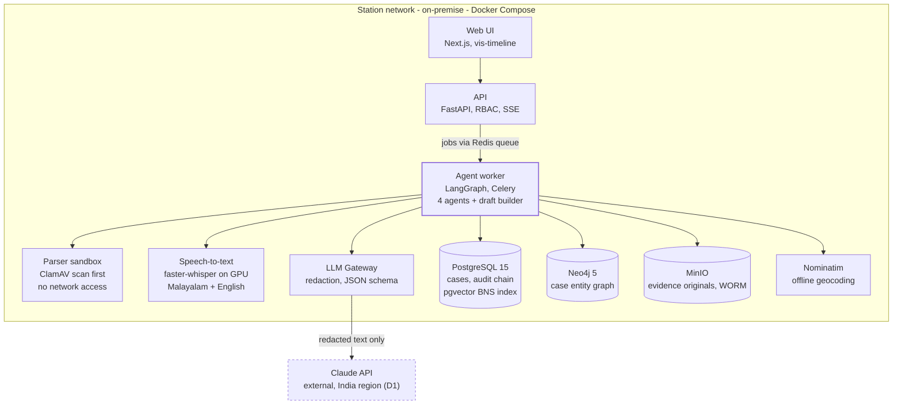
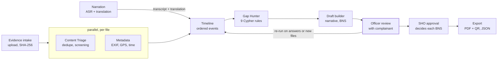

# TRACE — Technical Requirements Document (TRD)

Version 1.0 · 16 Oct 2026

> Part of the TRACE requirements set. Shared decisions (D1–D7), glossary, legal references and open questions live in [README.md](README.md). Companion documents: [PRD](PRD.md) · [TRD](TRD.md) · [SRS](SRS.md).

## 2.1 Architecture overview

TRACE is a single-agency system packaged with Docker Compose and run on-premise. A Next.js interface talks to a FastAPI backend. The backend hands analysis jobs to a worker that runs the LangGraph agent pipeline. Evidence files, the case database and the entity graph all stay inside the station network. The only traffic that leaves goes through the LLM Gateway, and that traffic is redacted text, depending on decision D1.



Only the LLM Gateway has a path out of the station network, and in local-model mode (the D1 fallback) even that path is closed. Parsers handle untrusted files in a sandbox that has no network access.

## 2.2 Technology stack

The table keeps the stack from the proposal. Rows marked **(added)** or **(changed)** are recommendations from this document.

| Layer | Choice | Purpose | Notes |
| --- | --- | --- | --- |
| Frontend | Next.js 14, Tailwind, shadcn/ui, vis-timeline | Officer interface and chronology view | Malayalam fonts bundled locally; no external CDNs, so it works offline |
| API | FastAPI on Python 3.11, Pydantic v2 | REST API, authentication, validation | Versioned under `/api/v1` |
| Orchestration | LangGraph | Agent graph, state, retries, checkpoints | Checkpoints saved to Postgres, so a run can resume after a crash |
| Job queue **(added)** | Celery + Redis | Runs long jobs (speech-to-text, agents) outside API requests | Keeps API calls under 500 ms |
| LLM | Anthropic Claude, `claude-sonnet-5` by default, set in config (D2) | Narrative synthesis, translation, entity extraction, gap reasoning, BNS mapping | Called only through the LLM Gateway (§2.4) |
| Speech-to-text **(changed)** | Whisper large-v3 served with faster-whisper; Indic fine-tuned model as a candidate (D7) | Transcribe Malayalam and English narration and voice notes | faster-whisper is several times faster than reference Whisper on the same GPU |
| NER | spaCy (English) + LLM extraction | Entities from English text and translations | Malayalam text is translated first; entities are mapped back to the original by the LLM |
| Image forensics | OpenCV (DFT spectrum, noise residuals), plus ELA (error-level analysis) **(added)** | Manipulation screening | Calibrated on the D6 dataset; produces flags, never verdicts |
| Deduplication | imagehash (pHash, dHash) | Collapse near-duplicate screenshots | Default Hamming threshold 6, tuned on real bundles |
| Metadata | Pillow, piexif, plus pdfplumber **(added)** for bank-statement PDFs and mutagen **(added)** for audio tags | EXIF, GPS, timestamps, document text |  |
| Geocoding **(changed)** | **Self-hosted** Nominatim with an OpenStreetMap extract for India | Turn GPS coordinates into places | The public Nominatim server would send coordinates off-site and isn't allowed for bulk use |
| Language detection | langdetect, with fastText lid.176 as fallback | Route text and audio | langdetect is unreliable on short chat messages |
| Relational DB | PostgreSQL 15, SQLAlchemy 2, Alembic, pgvector **(added)** | Cases, audit chain, BNS retrieval index |  |
| Graph DB | Neo4j 5 Community | Case entity graph for the Gap Hunter | One graph per case, separated by `case_id` |
| Evidence store **(added)** | MinIO with object lock (WORM: write once, read many) | Stores original files that can't be overwritten | Originals are never modified; derived files are kept separately |
| Malware scan **(added)** | ClamAV | Scan uploads before parsing |  |
| PDF export | WeasyPrint + qrcode | Draft FIR and manifest PDFs with a QR code |  |
| Observability **(added)** | Structured JSON logs, Prometheus, Grafana | Health, latency per agent, error rates | No personal data in logs |

## 2.3 Agent pipeline

Triage and Metadata work file by file and don't depend on each other, so they run **in parallel**. Timeline needs both results. Gap Hunter runs on the finished timeline. When the officer adds answers or files, only the affected steps re-run.



The officer's answers and any added files re-run only the affected steps. Filing happens outside TRACE, after export.

**Shared state (LangGraph).** Every agent reads and writes one typed `CaseState`: `case_id`, `run_id`, `evidence[]` (with type, hash, duplicate group, flags and metadata), `narrations[]` (original text, translation, segments), `events[]`, `entities[]`, `gaps[]`, `bns_candidates[]`, `errors[]`. Each agent returns a partial update. A checkpoint is saved after every node.

| Agent | Input | Processing | Output | On failure or timeout |
| --- | --- | --- | --- | --- |
| **Content Triage** | Original files | 1) Check type by magic bytes; classify as financial record, conversation, media, call log, document or audio. 2) pHash and dHash, then group duplicates by Hamming distance. 3) For images: DFT spectrum peaks, JPEG double-compression signs, ELA and noise-residual consistency, combined into one score. | Evidence type, duplicate group with a canonical file, `screening_score` (0–1), `screening_reasons[]`, `referral_rank` | The file is marked "not screened" and the pipeline continues |
| **Metadata** | Original files | Read EXIF (DateTimeOriginal, Make/Model, Software, GPS), PDF metadata and audio tags. Reverse-geocode GPS offline. Compare against the claimed source: for example, a "phone camera photo" with Software=Photoshop, a timestamp after the upload time, or GPS far from the stated place. | `metadata{}`, `geo{}`, `conflicts[]` marked `absent` / `consistent` / `conflict` | The file is marked "metadata unavailable" |
| **Timeline** | Text from chats, SMS, statements and call logs; narration translation; metadata timestamps | Parse WhatsApp `.txt` exports and SMS formats with rules. The LLM pulls out events (who, what, when, amount, account, place) as JSON checked against a schema. Normalise dates to IST, merge duplicates, order events, and link each event to its source file and line. | `events[]` with `source_refs`, a confidence value and `time_precision` (exact, day or approximate); the entity graph is written to Neo4j | Rule-parsed events are kept and the officer sees a warning |
| **Gap Hunter** | Neo4j case graph, `events[]` | Run a fixed library of parameterised Cypher rules (§2.6). The LLM rewrites each result as a neutral question for the officer, with no judgement of credibility. | `gaps[]`: rule ID, severity, question in English (Malayalam optional), linked entities | Raw rule results are shown without the rewording |
| **Draft builder** (non-agent step) | Everything above | The LLM writes the chronological narrative using only `events[]`. Retrieval from a local BNS corpus (pgvector) returns candidate sections, and the LLM links each one to the facts that support it, quoting the section text. | Draft FIR JSON, BNS suggestions with citations, manifest, ranked referral list | Template draft from the events list |

## 2.4 LLM Gateway

Every model call goes through one internal service. This is what lets decision D1 stay open without rewriting the agents.

- **Swappable provider:** `anthropic` (direct or cloud region) or `local` (an open-weight model run on-premise), chosen in configuration.
- **Redaction:** the gateway replaces phone numbers, account numbers, Aadhaar/PAN patterns and names with stable placeholders before sending, then restores them in the response. Raw images and audio are never sent.
- **Structured output:** every prompt declares a JSON schema, and responses that fail validation are retried once.
- **Timeouts:** 30 s per call with one retry, then the agent's fallback path (graceful degradation).
- **Evidence-text injection:** chat text from evidence is wrapped in delimiters marked as data. The system prompt tells the model never to follow instructions found in evidence. Outputs are checked against the schema, never executed.
- **Versioning:** prompts are stored as versioned templates. Every call logs the prompt version, model ID, token counts, latency, and SHA-256 hashes of the input and output (not the content itself) to the audit chain.
- **Cost control:** per-case token budget, plus prompt caching for the large fixed system prompts and the BNS corpus excerpts.

## 2.5 Data model

**PostgreSQL (system of record)**

| Table | Key fields | Notes |
| --- | --- | --- |
| `stations` | id, name, district, code |  |
| `users` | id, station\_id, name, badge\_no, role, password\_hash, status | Roles: writer, sho, io, analyst, admin |
| `cases` | id, station\_id, ref\_no, status, created\_by, created\_at, approved\_by, approved\_at | Status: draft → analysing → review → approved → exported |
| `complainants` | id, case\_id, name, contact, language, consent\_at, consent\_text\_version | Encrypted columns for personal data |
| `evidence_files` | id, case\_id, filename, mime, size, sha256, object\_key, uploaded\_by, uploaded\_at, evidence\_type, dup\_group\_id, is\_canonical | Originals stored in MinIO under object lock |
| `evidence_analysis` | file\_id, run\_id, screening\_score, reasons jsonb, metadata jsonb, geo jsonb, conflicts jsonb | One row per run |
| `narrations` | id, case\_id, audio\_file\_id, lang, transcript\_orig, transcript\_en, segments jsonb, corrected\_by | Original and English both kept |
| `events` | id, case\_id, run\_id, occurred\_at, precision, actor, action, amount, currency, place, source\_refs jsonb, confidence |  |
| `gaps` | id, case\_id, rule\_id, severity, question, status (open / answered / dismissed), answer, dismissed\_reason | A reason is required to dismiss a gap |
| `bns_suggestions` | id, case\_id, section, title, supporting\_event\_ids, statute\_excerpt, decision, decided\_by | Decision: accepted / rejected / pending |
| `drafts` | id, case\_id, version, narrative\_en, narrative\_ml, body jsonb, created\_by | Every save is a new version |
| `referrals` | id, case\_id, file\_id, rank, reason, confidence |  |
| `audit_log` | seq, case\_id, actor\_id, action, payload\_hash, prev\_hash, entry\_hash, at | Append-only; the database role has INSERT only |
| `pipeline_runs` | id, case\_id, trigger, status, started\_at, finished\_at, node\_status jsonb |  |

**Neo4j (one graph per case, analysis only, rebuilt from Postgres)**

- Nodes: `Person`, `Phone`, `Account`, `Device`, `Location`, `Event`, `Transaction`, `EvidenceFile`, `Statement` (a narration segment).
- Relationships: `(:Person)-[:OWNS]->(:Phone|:Account|:Device)`, `(:Event)-[:INVOLVES]->(:Person)`, `(:Transaction)-[:FROM]->(:Account)`, `(:Transaction)-[:TO]->(:Account)`, `(:Event)-[:AT]->(:Location)`, `(:Event)-[:EVIDENCED_BY]->(:EvidenceFile)`, `(:Statement)-[:MENTIONS]->(*)`, `(:Event)-[:NEXT]->(:Event)`.
- Every node carries `case_id`. Every query filters on it.

## 2.6 Gap Hunter rule library

The rules are fixed, reviewed Cypher queries that take parameters. **The LLM never writes Cypher that gets executed.** This is the main defence against Cypher injection.

| Rule | Detects | Severity |
| --- | --- | --- |
| G-01 | A transaction mentioned in the narration with no supporting financial record | High |
| G-02 | A named person with no phone, account or address | Medium |
| G-03 | Delay between the last incident event and the report date over a threshold (default 7 days), with no reason recorded | Medium (shown as a question, never an accusation) |
| G-04 | One device or phone at two locations closer in time than travel would allow (speed over 900 km/h) | High |
| G-05 | Money moved to an account with no bank or IFSC recorded | High |
| G-06 | An event with only an approximate time where a source with an exact time may exist (for example, a bank SMS) | Low |
| G-07 | A suspect contact (phone, UPI ID or URL) that appears in evidence but not in the narration | Medium |
| G-08 | A file referenced in the narration ("he sent a photo") with no matching evidence | Medium |
| G-09 | Amounts that don't add up: the stated total loss differs from the sum of transactions | High |

Example (G-01):

```cypher
MATCH (s:Statement {case_id: $case_id})-[:MENTIONS]->(t:Transaction)
WHERE NOT (t)-[:EVIDENCED_BY]->(:EvidenceFile)
RETURN t.id AS txn, t.amount AS amount, t.occurred_at AS at
```

## 2.7 Integrity: hash chain and verification

Each case has its own append-only chain of hashes. Every upload, analysis run, edit, decision, approval and export becomes one entry.

```math
h_0 = \mathrm{SHA256}(\texttt{"TRACE"} \parallel station\_id \parallel case\_id), \qquad h_i = \mathrm{SHA256}\big(h_{i-1} \parallel \mathrm{canon}(e_i)\big)
```

- `canon(e)` means the entry encoded as canonical JSON (RFC 8785): sorted keys and UTF-8, so the same entry always produces the same hash.
- An evidence entry includes the SHA-256 of the original file, computed while the upload streams in, before anything else reads the file.
- **Daily station digest:** a scheduled job hashes the latest hash (head) of every active case into a station digest. The SHO signs it in the interface with the station key (Ed25519) and it is printed into the station register. This guards against an administrator rewriting a whole chain.
- **QR on export:** encodes `case_ref`, `export_version`, the head hash and an internal verification URL. Verification recomputes the chain from Postgres and the hashes of the MinIO originals.
- This is deliberately not a blockchain: one agency, one trust domain, simple to operate.

## 2.8 API design

REST over HTTPS, JSON, under `/api/v1`. Authentication uses short-lived access tokens with refresh tokens in httpOnly cookies. Long jobs return `202 Accepted` with a `run_id`; the interface follows progress through Server-Sent Events (SSE).

| Method | Path | Purpose | Roles |
| --- | --- | --- | --- |
| POST | `/auth/login`, `/auth/refresh`, `/auth/logout` | Sessions | All |
| POST / GET | `/cases`, `/cases/{id}` | Create a case, read one | writer, sho |
| POST | `/cases/{id}/consent` | Record complainant consent | writer |
| POST | `/cases/{id}/evidence` | Multipart upload, one or more files | writer |
| GET | `/cases/{id}/evidence` | Manifest with analysis results | writer, sho, io, analyst |
| GET | `/evidence/{fid}/content` | Stream the original (logged in the audit chain) | writer, sho, io, analyst |
| POST | `/cases/{id}/narrations` | Upload or record narration audio | writer |
| PATCH | `/narrations/{nid}` | Officer correction of transcript or translation | writer |
| POST | `/cases/{id}/runs` | Start or re-run the pipeline (`scope`: all or partial) | writer |
| GET | `/runs/{rid}/events` | SSE progress stream | writer, sho |
| GET | `/cases/{id}/timeline` | Ordered events with sources | all case roles |
| GET / PATCH | `/cases/{id}/gaps`, `/gaps/{gid}` | List gaps; answer or dismiss with a reason | writer, sho |
| GET / PUT | `/cases/{id}/draft` | Read the draft; save a new version | writer, sho |
| POST | `/bns-suggestions/{sid}/decision` | Accept or reject a suggestion | sho |
| POST | `/cases/{id}/approve` | SHO approval (locks the draft version) | sho |
| POST | `/cases/{id}/exports` | Produce PDF and JSON exports, manifest, referral sheet | sho |
| GET | `/cases/{id}/audit`, `/cases/{id}/audit/verify` | Audit trail and chain verification | sho, admin |
| GET | `/verify/{case_ref}/{head_hash}` | QR verification page | Network-internal |
| CRUD | `/admin/users` | User management | admin |

Errors follow RFC 9457 (`application/problem+json`). Every write takes an `Idempotency-Key` header.

## 2.9 Security

- **Authentication:** local accounts with argon2id password hashes, 8+ characters plus a lockout after 5 failed attempts. LDAP/AD integration is optional if the police network provides it. Idle sessions time out after 15 minutes.
- **Authorisation:** role-based access checked on every endpoint, plus station scoping: a user only sees their own station's cases. Analysts see only referred files.
- **Encryption:** TLS 1.2 or later inside the deployment (internal certificate authority). LUKS full-disk encryption on the host. Personal-data columns are encrypted at the application level (AES-256-GCM, keys in a local secrets file mounted read-only, upgradeable to a hardware security module later).
- **Upload handling:** extension and MIME allowlist, magic-byte check, 50 MB per file, 500 MB per case, a ClamAV scan, and decompression limits for ZIP chat exports (no nested archives, at most 1,000 entries, expansion ratio under 100:1). Parsers run in a separate worker container with no network access.
- **Graph:** parameterised Cypher only. The graph database user can only run the rule procedures.
- **LLM:** redaction, a filter on evidence text, schema-checked outputs, and no tool or code execution (§2.4).
- **Logging:** no personal data or evidence content in application logs. The audit chain records hashes and IDs.
- **Supply chain:** pinned dependencies, SBOM (software bill of materials) generated in CI, container image scanning, and offline update bundles signed by the vendor.
- **Assessment:** OWASP ASVS Level 2 as the target. The external audit from the budget line happens before multi-station rollout.

## 2.10 Testing and evaluation

| Layer | What | Pass bar (proposed) |
| --- | --- | --- |
| Unit | Parsers, hashing, Cypher rules, redaction | 80% or more line coverage on core modules |
| Integration | API to worker to databases, run inside Docker Compose in CI | All critical paths green |
| Agent golden set | 25 anonymised synthetic cases, each with a known timeline, gaps and sections | Timeline event recall 90% or more; gap-rule recall 85% or more; zero invented events in the narrative |
| Manipulation calibration | D6 dataset, including WhatsApp-recompressed images | False-positive and false-negative rates published per class; nothing claimed beyond what was measured |
| Speech-to-text | 30+ consented complaint recordings | WER 25% or less (Malayalam); named-entity accuracy reported |
| Security | SAST, dependency scan, ZAP baseline, manual tests for prompt injection and Cypher injection | No high or critical findings open at pilot |
| Usability | Five-officer test sessions in Months 3 and 4 | SUS 70 or more |

## 2.11 Deployment

- **Packaging:** one `docker-compose.yml` with these services: `web`, `api`, `worker` (agents), `asr` (GPU), `parser` (sandboxed), `postgres`, `neo4j`, `redis`, `minio`, `nominatim`, `clamav`, `llm-gateway`, `prometheus`, `grafana`, and a reverse proxy (Caddy or nginx).
- **Reference station hardware (proposed, to be checked by load test):** one server with 16 CPU cores, 64 GB RAM, one 16–24 GB NVIDIA GPU, 2 TB of mirrored SSD, and a UPS. Without a GPU, transcription runs on CPU and is about 5–10 times slower.
- **Network:** reachable only on the station LAN or police intranet. The only outbound connection is from `llm-gateway` (if D1 chooses cloud), through an allowlisted proxy.
- **Backups:** nightly encrypted Postgres dump, MinIO replication to a second disk, a monthly restore drill; RPO 24 h and RTO 8 h (how much data may be lost, and how long recovery may take).
- **Updates:** signed offline bundles, applied by the vendor with the station administrator present; Alembic migrations, with rollback tested.

## 2.12 Performance budgets

| Operation | Budget (reference hardware) |
| --- | --- |
| API read (p95) | 300 ms or less |
| Upload acknowledgement with hash, 50 MB file | 5 s or less |
| Transcription, 10 minutes of audio (GPU) | 2 min or less |
| Full pipeline, 50 files plus 10 minutes of narration | 6 min or less, with first results streamed within 60 s |
| Gap re-run after the officer answers | 30 s or less |
| PDF export | 10 s or less |
